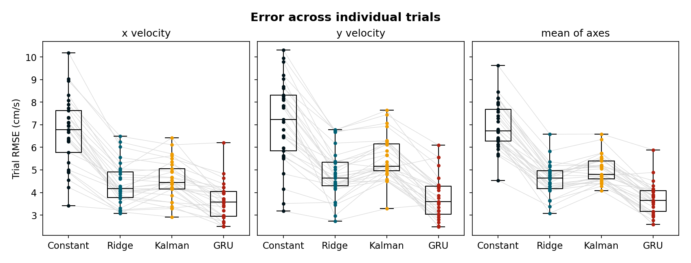
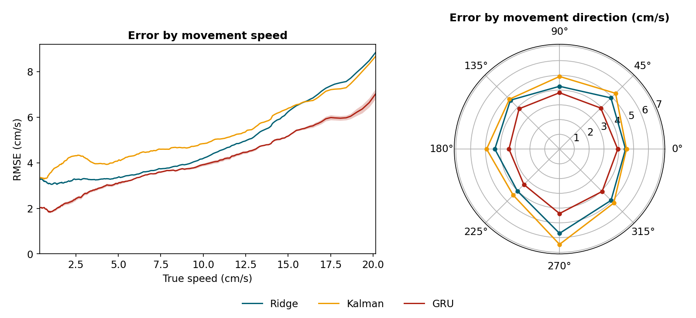

# Neural decoding of cursor velocity from M1 and PMd spiking activity

This project decodes two-dimensional cursor velocity from M1 and PMd sorted-unit
spiking activity in one public recording session. The implemented models use only
causal neural inputs and preserve complete trials throughout selection and
evaluation.

## Held-out results

The four decoders were evaluated on 10,215 samples from 29 held-out trials. GRU
values are the arithmetic mean across three independently trained models.

| Model | Held-out R² (x, y) | Mean R² | Mean correlation | Mean RMSE (cm/s) |
| --- | --- | --- | --- | --- |
| Constant baseline | -0.000232, -0.000145 | -0.000189 | undefined | 7.091 |
| Ridge | 0.569978, 0.541104 | 0.555541 | 0.746 | 4.729 |
| Kalman | 0.548479, 0.410590 | 0.479535 | 0.712 | 5.118 |
| GRU, three-seed mean | 0.705882, 0.696905 | **0.701393** | 0.838 | 3.875 |

The constant model predicts the mean training velocity and uses no neural data.
Constant and Ridge artifacts are under
[`results/baselines/`](results/baselines/), with validation metrics in
[`results/baseline_summary.json`](results/baseline_summary.json). Kalman results
and models are under
[`results/kalman_decoder_selection/`](results/kalman_decoder_selection/) and
[`results/kalman_validation/`](results/kalman_validation/). GRU results and
trained models are under
[`results/gru_input_selection/`](results/gru_input_selection/) and
[`results/gru_architecture_selection/`](results/gru_architecture_selection/).
Held-out metrics and predictions are under
[`results/held_out_evaluation/`](results/held_out_evaluation/).

### Error analysis

Across the 29 held-out trials, median RMSE was 3.65 cm/s for GRU, 4.65 cm/s for
Ridge, and 4.80 cm/s for Kalman. GRU had the lowest error among the neural
decoders in every speed quartile and movement-direction sector. The constant
baseline had the lowest RMSE in the two slowest quartiles, while GRU led in the
two faster quartiles.





Velocity traces and integrated relative trajectories are shown for objectively
selected [low-error](reports/figures/held_out_lowest_error_trial.png),
[median-error](reports/figures/held_out_median_trial.png), and
[high-error](reports/figures/held_out_highest_error_trial.png) trials. Trial
metrics and the complete analysis summary are available in
[`results/held_out_analysis/`](results/held_out_analysis/).

## Data

The NWB recording is not included in the repository:

| Field | Value |
| --- | --- |
| Dandiset | [DANDI 000688](https://doi.org/10.48324/dandi.000688/0.250122.1735) |
| Version | `0.250122.1735` |
| License | CC BY 4.0 |
| Subject and session | subject T, random-target task, 2013-09-06 |
| File | `sub-T/sub-T_ses-RT-20130906_behavior+ecephys.nwb` |
| Size | 41,528,428 bytes |

Download it to any location outside the repository.

## Setup

Python 3.11 is recommended:

```powershell
conda env create -f environment.yml
conda activate neural-decoding
```

Create `configs/local.yaml` with the local NWB path:

```yaml
paths:
  nwb_file: "D:/path/to/sub-T_ses-RT-20130906_behavior+ecephys.nwb"
```

For a single run, the environment variable below overrides the local file:

```powershell
$env:NEURAL_DECODING_NWB_FILE = "D:/path/to/sub-T_ses-RT-20130906_behavior+ecephys.nwb"
```

CPU execution is sufficient for the classical decoders and GRU inference. A CUDA
GPU is recommended for GRU training and configuration selection.

## Methods

### Ridge

Each sample pairs 200 ms of causal spike history, as four chronological half-open
50 ms bins across all 53 units, with the cursor velocity at a later target time.
Five grouped training folds selected a 50 ms lag and Ridge alpha 10,000. The
final model was fitted on the complete training set.

### Kalman decoder

The training-only search compares four state definitions (`V`, `PV`, `VA`, and
`PVA`), neural count widths of 10, 20, and 50 ms, and interval-end lags of 0, 50,
and 100 ms. Each candidate uses fresh non-overlapping spike counts and is assessed
recursively without access to the true velocity or acceleration. Position is
provided only at the start of each trial when it belongs to the state.

The selected `PVA / 50 ms width / 50 ms lag` configuration achieved a mean
out-of-fold R² of 0.506909. The final model was fitted on the complete training
set and is included at
[`results/kalman_validation/model.json`](results/kalman_validation/model.json).

### GRU decoder

The sequence-to-one GRU uses the same 53 units. Input selection compared 100 and
200 ms histories with 10, 20, and 50 ms bins while keeping the neural interval
end 50 ms before the velocity target. The selected input contains four
chronological 50 ms bins spanning 200 ms.

Architecture selection compared one- and two-layer GRUs, hidden sizes 32, 64,
and 128, learning rates 0.001 and 0.0003, and dropout 0 or 0.2 where applicable.
Each configuration used seeds 0, 1, and 2. The selected model has two layers,
hidden size 128, dropout 0.2, and learning rate 0.001. Its complete configuration
is in
[`results/gru_architecture_selection/final_configuration.json`](results/gru_architecture_selection/final_configuration.json);
the directory also contains all three fitted seed checkpoints.

### Incremental replay and latency

Timestamp-ordered replay on all 8,183 validation targets reproduced the batch
predictions. The largest difference was \(2.1\times10^{-14}\) cm/s for Ridge,
\(7.4\times10^{-6}\) cm/s across the three GRU seeds, and zero for Kalman.

With models loaded and file I/O excluded, p95 compute time per target was 0.016
ms for Ridge, 0.139 ms for Kalman, and at most 0.473 ms for a GRU seed. Ridge
and Kalman ran on CPU; GRU ran on an NVIDIA RTX 4090. These measurements cover
decoder computation, not end-to-end acquisition or control latency.

The replay implementation is in
[`scripts/verify_replay_latency.py`](scripts/verify_replay_latency.py), with
methods, checks, environment details, and results in
[`results/replay_latency/summary.json`](results/replay_latency/summary.json).

## Limitations

This is an offline, within-session result from one subject and one recording.
Neither cross-session nor cross-subject generalization has been tested. The
Kalman posterior is overconfident—its nominal 95% velocity ellipse covered 86.15%
of validation targets—and its process and innovation residuals remain temporally
correlated. It should be treated as a causal linear decoder, not as a fully
calibrated probabilistic model.

## Run the tests

```powershell
pytest
```

The tests run without the NWB recording.

## Repository layout

| Path | Contents |
| --- | --- |
| `neural_decoding/` | Reusable package: configuration, logging, seeding, session loading, trial splits, feature construction, lag selection, metrics, decoders |
| `configs/` | Tracked defaults, plus an untracked local override for paths |
| `scripts/` | Runnable entry points, invoked as `python -m scripts.<name>` |
| `tests/` | Automated tests, run with `pytest` |
| `results/` | Model-selection metrics, trained model artifacts, and held-out predictions |
| `reports/` | Generated figures and report tables |

`requirements.txt` records the dependency versions used to verify the project.
