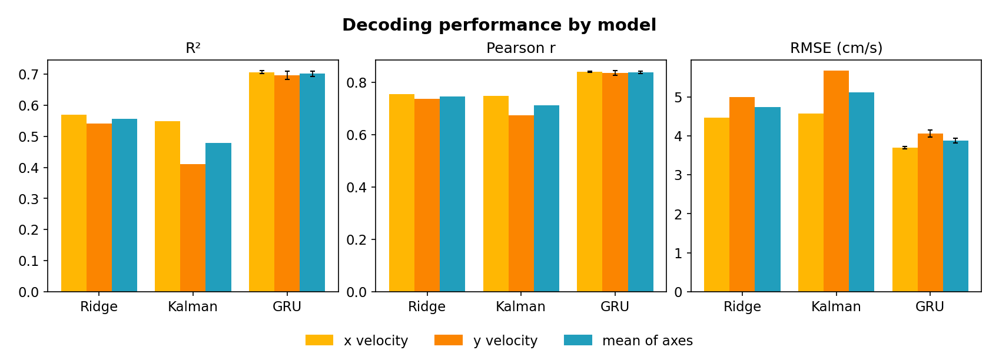
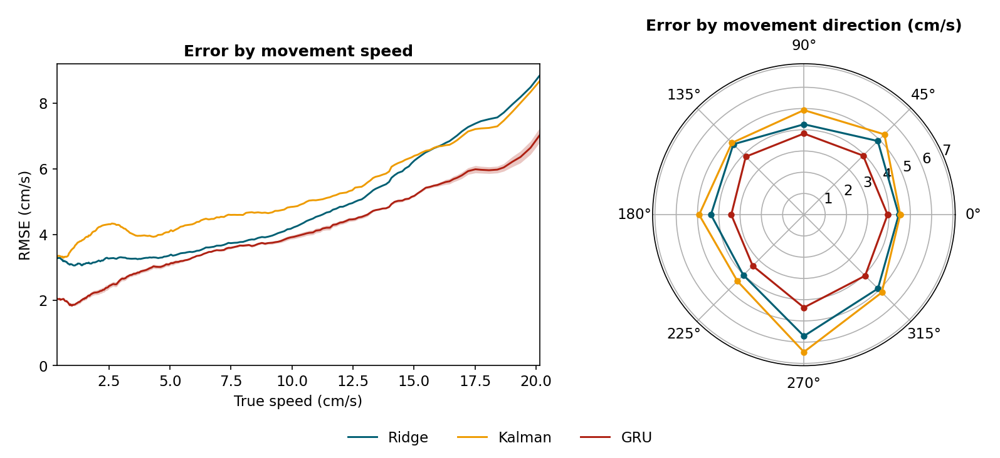
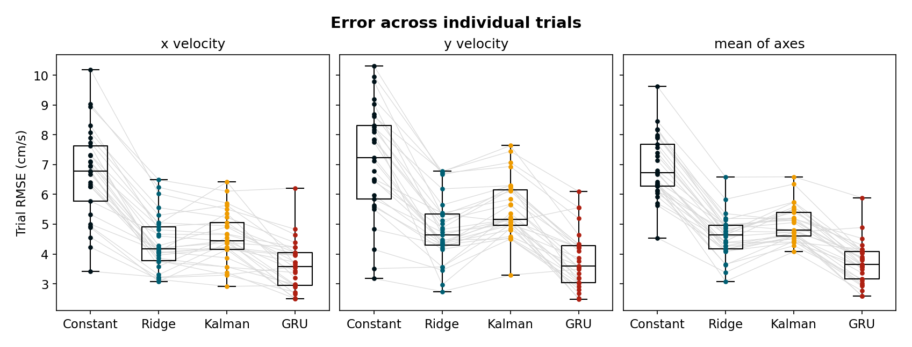
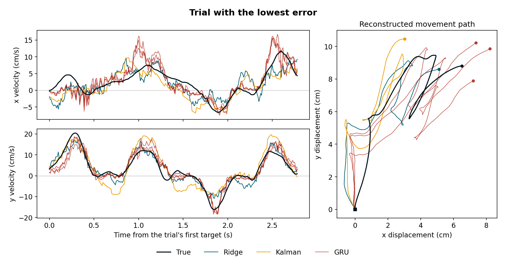
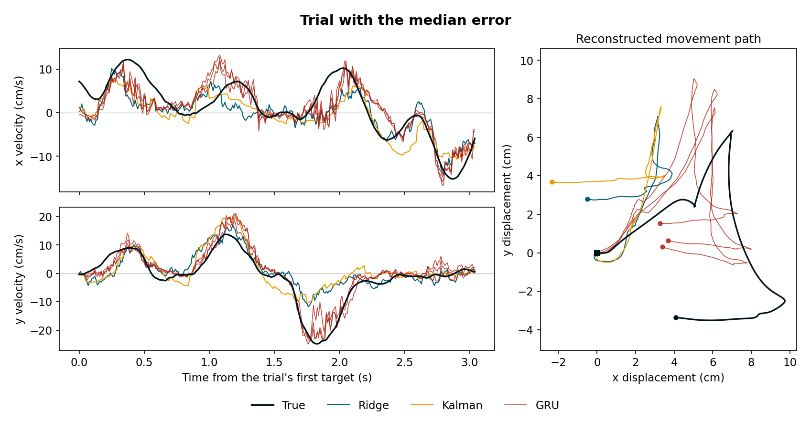
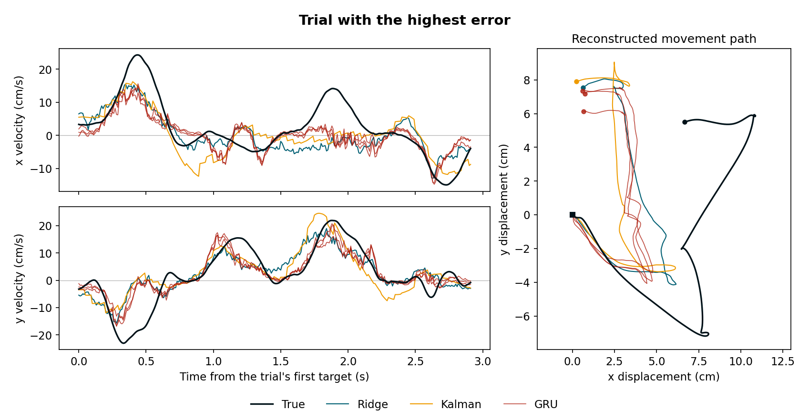

# Neural decoding of cursor velocity from M1 and PMd spiking activity

## Abstract

This project compares linear, state-space, and recurrent neural decoders on one
public motor-cortex recording. The task is to predict two-dimensional cursor
velocity from sorted-unit activity in primary motor cortex (M1) and dorsal
premotor cortex (PMd). All models use causal neural inputs, preserve trial
boundaries, and are evaluated on the same target timestamps.

The final held-out comparison contains 10,215 targets from 29 trials. Mean
held-out R² was 0.556 for Ridge regression, 0.480 for the Kalman decoder, and
0.701 for the three-seed GRU result. Timestamp-ordered replay reproduced the
batch predictions within numerical tolerance.

## Data

The recording is from
[DANDI 000688, version 0.250122.1735](https://doi.org/10.48324/dandi.000688/0.250122.1735):

- Subject T, random-target task, session 2013-09-06
- 53 simultaneously recorded sorted units from M1 and PMd
- Cursor behavior sampled at 100 Hz
- Position in centimetres and velocity in centimetres per second

The target is the stored horizontal and vertical cursor velocity. Neural and
behavioral samples never cross trial boundaries.

Eligible trials were assigned once to three disjoint groups:

| Split | Trials | Targets | Purpose |
| --- | ---: | ---: | --- |
| Training | 123 | 43,022 | Parameter fitting and grouped cross-validation |
| Validation | 24 | 8,183 | GRU selection and early stopping; final checks for linear models |
| Held-out | 29 | 10,215 | Final decoder comparison |

Trials were split as complete units, so samples from one trial never appeared
in multiple splits.

## Common timing and evaluation

Cursor velocity is evaluated every 10 ms. Ridge and GRU use four chronological
50 ms spike-count bins spanning 200 ms. For a velocity target at time \(t\), the
neural interval is

\[
[t-250\ \mathrm{ms},\ t-50\ \mathrm{ms}).
\]

The 50 ms gap is the neural-to-behavior lag. Every bin and target lies inside one
trial. Count and target normalization is fitted on training data and applied
unchanged outside training.

The final comparison uses identical ordered target rows for every decoder.
Reported metrics are:

- coefficient of determination (R²);
- Pearson correlation;
- root-mean-square error (RMSE) in cm/s.

R², correlation, and RMSE are reported by axis and averaged across axes. GRU
metrics are averaged across three independently trained seeds.

The mean-velocity baseline predicts the mean training velocity,
\((0.062,\ 0.460)\) cm/s, for every target and uses no neural input.

## Decoders

### Ridge regression

Ridge receives 212 inputs: four spike-count bins for each of 53 units. Five
trial-grouped training folds selected a 50 ms lag and regularization strength
\(\alpha=10{,}000\). The final model was fitted on all 43,022 training targets.

On validation, Ridge reached mean R² 0.548, mean correlation 0.745, and mean
RMSE 5.014 cm/s.

### Kalman decoder

The Kalman search jointly compared:

- velocity (`V`), position–velocity (`PV`), velocity–acceleration (`VA`), and
  position–velocity–acceleration (`PVA`) states;
- neural count widths of 10, 20, and 50 ms;
- interval-end lags of 0, 50, and 100 ms.

All 36 combinations were evaluated in five grouped training folds. Neural
observations use fresh, non-overlapping counts. State propagation occurs every
10 ms; with the selected 50 ms count width, four state steps between neural
updates are prediction-only.

The selected model uses the six-dimensional PVA state, a 50 ms neural count, and
a 50 ms lag. Its mean out-of-fold R² was 0.507. The transition is a full affine
linear model. The neural observation covariance uses Oracle Approximating
Shrinkage, and filtering uses a numerically stable information-form update.

Kalman used the recorded trial-start position and training-derived velocity and
acceleration priors.

After fitting on all training trials, the decoder reached mean validation R²
0.500, mean correlation 0.720, and mean RMSE 5.267 cm/s.

### GRU decoder

The GRU is a sequence-to-one model. Each target is an independent four-step
sequence of 53-dimensional spike counts; hidden state is reset for every target.

Input selection compared:

- 100 and 200 ms histories;
- 10, 20, and 50 ms bins;
- seeds 0, 1, and 2.

The selected input was a 200 ms history with four 50 ms bins. Architecture
selection then compared one or two GRU layers, hidden sizes 32, 64, and 128,
learning rates 0.001 and 0.0003, and dropout 0 or 0.2 where applicable.

The final architecture has two layers, hidden size 128, dropout 0.2, and
learning rate 0.001. Each seed was trained on the complete training set with
validation-based early stopping, and its best checkpoint was restored. The
three-seed validation result was mean R² 0.676, mean correlation 0.826, and mean
RMSE 4.239 cm/s.

Validation controlled GRU input selection, architecture selection, and early
stopping.

## Held-out results

The trained models were applied to the same 10,215 targets from all 29 eligible
held-out trials.

| Model | R² (x, y) | Mean R² | Mean correlation | Mean RMSE (cm/s) |
| --- | --- | ---: | ---: | ---: |
| Mean-velocity baseline | -0.000232, -0.000145 | -0.000189 | undefined | 7.091 |
| Ridge | 0.569978, 0.541104 | 0.555541 | 0.746 | 4.729 |
| Kalman | 0.548479, 0.410590 | 0.479535 | 0.712 | 5.118 |
| GRU, three-seed mean | 0.705882, 0.696905 | 0.701393 | 0.838 | 3.875 |

GRU had the highest R², highest correlation, and lowest RMSE. Its seed-level
mean-R² standard deviation was 0.0091 and its mean-RMSE standard deviation was
0.060 cm/s. Ridge ranked second overall. Kalman was similar to Ridge on
horizontal velocity but was less accurate on vertical velocity.



The prediction table and exact metric definitions are in
[`results/held_out_evaluation/`](results/held_out_evaluation/).

## Error analysis

Trial-level median RMSE was:

- 6.721 cm/s for the mean-velocity baseline;
- 4.647 cm/s for Ridge;
- 4.797 cm/s for Kalman;
- 3.649 cm/s for GRU.

Error increased with true movement speed. The mean-velocity baseline had the
lowest RMSE in the two slowest quartiles because those targets were close to zero.
Among the neural decoders, GRU had the lowest RMSE in every speed quartile. It
also had the lowest RMSE in every 45-degree movement-direction sector. Downward
movement (the sector centred at 270 degrees) was the most difficult direction
for all three neural decoders.





Example trials were selected by the mean of Ridge, Kalman, and GRU trial RMSE:
trial 212 was the lowest-error example, trial 207 the median, and trial 214 the
highest. Relative trajectories were obtained by integrating velocity from a
common origin.

Low-error trial:



Median-error trial:



High-error trial:



The complete trial metrics and bin definitions are in
[`results/held_out_analysis/`](results/held_out_analysis/).

## Incremental replay and latency

Incremental replay was checked on all 8,183 validation targets. Ridge and GRU
received spikes through a timestamp-ordered rolling buffer. Kalman reused its
recursive validation path while its initialization, propagation, prediction-only
steps, and neural-update schedule were instrumented.

Replay reproduced the batch results:

- Ridge maximum absolute difference: \(2.1\times10^{-14}\) cm/s;
- GRU maximum absolute difference across seeds: \(7.4\times10^{-6}\) cm/s;
- Kalman maximum absolute difference: zero.

With models already loaded and file I/O excluded, p95 total compute time per
target was:

| Decoder | Device | p95 latency |
| --- | --- | ---: |
| Ridge | CPU | 0.016 ms |
| Kalman | CPU | 0.139 ms |
| GRU seed, slowest of three | NVIDIA RTX 4090 | 0.473 ms |

These numbers measure preprocessing and decoder inference on one workstation.
They do not include neural acquisition, spike sorting, data transport, display,
or control-loop latency. The implementation and full benchmark environment are
recorded in
[`scripts/verify_replay_latency.py`](scripts/verify_replay_latency.py) and
[`results/replay_latency/summary.json`](results/replay_latency/summary.json).

## Limitations

- This is an offline, within-session analysis of one subject and one recording.
  Cross-session and cross-subject generalization were not tested.
- Sorted units were supplied by the dataset. Online spike-sorting stability and
  unit loss were not evaluated.
- No closed-loop cursor-control experiment was performed.
- The held-out split contains 29 trials from the same session. Subgroup analyses
  by speed, direction, and trial are descriptive.
- The Kalman posterior is overconfident: its nominal 95% velocity ellipse covered
  86.15% of validation targets. Process and innovation residuals also remain
  temporally correlated, so its posterior should not be treated as fully
  calibrated uncertainty.
- Replay latency is hardware- and implementation-specific and is not an
  end-to-end real-time-system benchmark.

## Reproducibility and public artifacts

The recording itself is not included. Download the NWB file listed in the
[README](README.md), create `configs/local.yaml`, and use the provided
`environment.yml` or `requirements.txt`.

The main public artifacts are:

- Mean-velocity baseline and Ridge models and validation predictions:
  [`results/baselines/`](results/baselines/)
- Ridge validation metrics:
  [`results/baseline_summary.json`](results/baseline_summary.json)
- Kalman selection results:
  [`results/kalman_decoder_selection/`](results/kalman_decoder_selection/)
- Kalman model, configuration, and validation:
  [`results/kalman_validation/`](results/kalman_validation/)
- GRU input and architecture selection:
  [`results/gru_input_selection/`](results/gru_input_selection/) and
  [`results/gru_architecture_selection/`](results/gru_architecture_selection/)
- Held-out predictions and metrics:
  [`results/held_out_evaluation/`](results/held_out_evaluation/)
- Trial-level analysis and figures:
  [`results/held_out_analysis/`](results/held_out_analysis/) and
  [`reports/figures/`](reports/figures/)
- Replay and latency summary:
  [`results/replay_latency/summary.json`](results/replay_latency/summary.json)

Run the automated tests with:

```powershell
pytest
```

The tests do not require the NWB recording.

## Conclusion

All three neural decoders recovered substantial held-out cursor-velocity
variance from M1 and PMd spiking activity. Ridge provided a strong linear
baseline. The causal Kalman formulation produced a competitive horizontal
velocity estimate but weaker vertical performance and imperfect uncertainty
calibration. The compact GRU performed best overall and remained the strongest
neural decoder across every analyzed speed and direction group. The replay check
showed that the saved decoders can reproduce their batch predictions from
timestamp-ordered inputs with sub-millisecond decoder computation on the tested
hardware.
